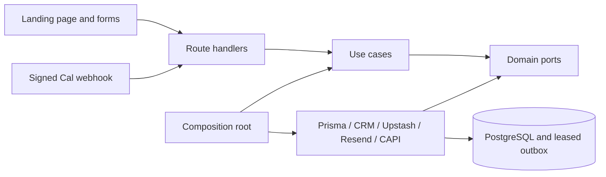

# Bizgenix AI CRM campaign landing page

Next.js App Router, strict TypeScript and a mobile-first Bizgenix landing page. Includes approved content, accessible Radix navigation/dialogs/FAQ/selects, separate demo and pricing enquiries, PostgreSQL lead capture, Cal.com lifecycle handling, delivery outbox and consent-aware marketing tracking.

## Run

Use Node.js 24 and pnpm 10.34.7. On Windows, use `pnpm.cmd` if PowerShell blocks script shims.

```powershell
pnpm install
Copy-Item .env.example .env.local
pnpm dev
```

Without a database, forms use an explicit server-session preview store and do not send CRM/email notifications or invent bookings. Configure real providers using [SETUP_GUIDE.md](SETUP_GUIDE.md). Full production mode refuses missing required settings and the absent official SVG. The generic CRM HTTP adapter must be verified against the real contract.

## Commands

| Command                      | Purpose                                                 |
| ---------------------------- | ------------------------------------------------------- |
| pnpm dev / build / start     | Develop, compile, serve production build                |
| pnpm lint / typecheck / test | ESLint, strict types, unit and CRM contract tests       |
| pnpm test:integration        | Disposable PostgreSQL transaction and concurrency tests |
| pnpm test:e2e                | Chromium desktop/mobile flows and axe accessibility     |
| pnpm format / format:check   | Format / validate source formatting                     |
| pnpm db:generate             | Generate Prisma client                                  |
| pnpm db:migrate / db:deploy  | Development / deployment migrations                     |
| pnpm db:seed / db:studio     | Verify development DB / browse records                  |

## Architecture



[Architecture](docs/ARCHITECTURE.md), [tracking QA](docs/TRACKING_QA.md), [verification](docs/verification.md).

## Conventions and release

Approved copy and feature flags live in `src/content/landing.ts`. Keep server credentials out of client props, logs and dataLayer. Domain ports isolate adapters; route handlers delegate; `src/composition/container.ts` is the composition root. Use pnpm-lock.yaml in CI; the retained npm lockfile records the dependency installation bootstrap. Husky runs lint-staged. Configure the CI check as a required GitHub ruleset manually.

Add the original official SVG at `public/brand/bizgenix-logo.svg` unchanged. Add a verified/anonymized screenshot at `public/product/dashboard.webp`; otherwise the page labels its styled interface as illustrative. No testimonials, exact prices or unsupported performance numbers are introduced.

No external accounts, DNS, production deployment, CRM commercial contract or campaign settings are created automatically. Provider acceptance testing and manual setup are required before traffic. `vercel.json` requests a one-minute cron and requires a hosting plan that supports it; see the scheduler alternatives in the setup guide.
