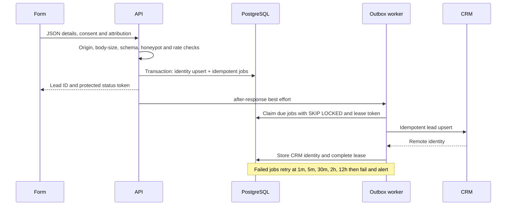

# Architecture and operational boundaries

## Layers

| Layer          | Responsibility and allowed dependencies                                           |
| -------------- | --------------------------------------------------------------------------------- |
| app            | Server rendering and thin request/response adapters; delegates to composition     |
| components     | Presentation, accessible interactions, API calls; no server secrets               |
| content        | Approved typed marketing copy and feature verification flags                      |
| shared         | Zod input/provider contracts used by browser and server                           |
| domain         | Framework-independent entities and ports                                          |
| application    | Lead capture and delivery use cases; depends on ports and pure policies           |
| infrastructure | Concrete Prisma, HTTP CRM, mock CRM, email, Redis, logging adapters               |
| composition    | Wires concrete adapters into use cases; chooses explicit preview store without DB |
| config         | Validated runtime settings, public site settings and role routing                 |

Single responsibility separates validation, transport, persistence and delivery. Dependency inversion uses gateway/repository/limiter ports. The shared mock/HTTP contract suite checks substitution. Adapters extend capabilities without editing capture use cases. Narrow interfaces keep callers from depending on unrelated provider functions. Booking transaction semantics live in the booking repository; the provider boundary remains Cal.com-specific.

## Data flows



```mermaid
sequenceDiagram
 participant Cal as Cal.com
 participant Hook as Webhook
 participant DB as PostgreSQL
 participant Browser
 participant Worker as Outbox
 participant Dest as CRM / Email / Meta
 Cal->>Hook: Raw JSON with HMAC SHA256 signature
 Hook->>Hook: Constant-time signature and payload validation
 Hook->>DB: Transaction: event dedupe, UID lock, lifecycle upsert, jobs
 Note over Hook,DB: Older lifecycle events cannot overwrite newer state
 Hook-->>Cal: Acknowledgement
 Cal-->>Browser: bookingSuccessfulV2 (may be pending)
 Browser->>Hook: Protected booking-status polling
 Hook-->>Browser: Only persisted provider state
 Browser->>Browser: Show confirmed state; once-only conversion
 Worker->>Dest: Idempotent CRM/email; consent-gated CAPI
 Note over Browser,Dest: Browser and CAPI use Cal booking UID as event_id
```

## Reliability

Identity is SHA256(lowercase email + colon + E.164 mobile). Matching identity updates the same record and preserves sales status. Identical validated submissions share delivery keys; changed inputs enqueue a new revision. Lead and delivery jobs commit atomically. Browser lead tracking uses a stable lead event ID.

Webhook dedupe includes UID, event type and provider event time. Advisory transaction locks serialize events for one UID. Metadata leadId is trusted only if its email matches the provider attendee; otherwise the most recently updated matching email is used. If multiple records share an email, this fallback is ambiguous: validate metadata on the real Cal event before launch. Unknown attendees are stored as unlinked bookings for operator review; they cannot create marketing leads or conversions.

Outbox claims use FOR UPDATE SKIP LOCKED. Leases expire after five minutes and ownership tokens prevent stale workers completing a newer claim. Jobs run in bounded batches of five. Provider calls use idempotency keys; external systems must honor them. Resend deduplicates only within its provider retention window; a crash/retry after that window cannot provide absolute exactly-once email. Monitor stuck/failed jobs and provider request IDs. CRM delivery uses a generic placeholder REST contract until the backend owner approves it.

## Privacy and security

Server configuration is never serialized; only explicit public fields from `config/site.ts` reach the browser. JSON lead requests require the configured same origin. Requests are size-bounded, schema-validated, honeypot checked and rate limited independently by hashed IP and email. Public booking status requires an HMAC capability token and returns minimal booking details. Rotate CRON_SECRET to invalidate status capabilities; tokens are not logged.

Consent Mode v2 defaults denied. GTM loads after acceptance; ad/analytics events and long-lived attribution cookies are suppressed until acceptance. Current URL campaign parameters can accompany a voluntarily submitted enquiry even without persistent analytics storage. Do not put PII in campaign parameters. The server only copies allowlisted attribution fields. CAPI matching uses SHA256-normalized email/phone and only sends for a stored accepted marketing choice. A later site consent rejection suppresses new browser events; already submitted consent records need a privacy-request process to withdraw queued server processing across devices.

Pino emits codes/opaque IDs, not provider bodies. Sentry strips request/user/breadcrumb data and uses generic error messages. CSP permits inline scripts/styles for statically rendered Next.js and the configured embed/tracking integrations; it is not a nonce-based strict CSP. Tighten host allowlists after GTM setup and verify Tag Assistant on staging. HSTS is production-only; preview has noindex headers, metadata and robots. Retention/deletion duration requires management approval; no arbitrary retention period is claimed. Delete lead-linked outbox payloads, bookings and webhook payloads together when honoring approved erasure requests. Use provider access controls and backups.
